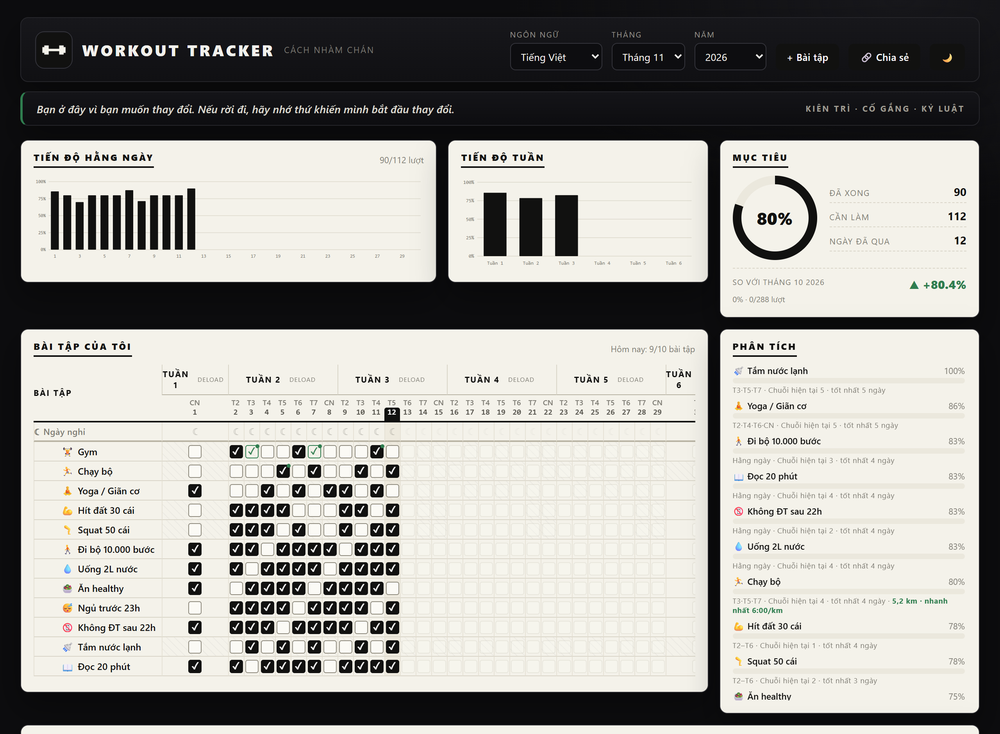

# Workout Tracker

**A local-first workout, routine and habit tracker that runs in your browser.**
No account, no server, no tracking — your data stays on your device.

[**Open the app →**](https://thanhson03.github.io/workout-tracker/)

[English](#english) · [Tiếng Việt](#vietnamese)

---

## English

### What is it?

Workout Tracker is a Progressive Web App for planning workouts, ticking off daily habits, logging sets/reps/weight, following routines and tracking recovery. It is designed to be **installed like an app** and used **without an internet connection** after the first load.

### Install

| Device | How |
| --- | --- |
| **iPhone / iPad** | Open the link in **Safari** → **Share** → **Add to Home Screen** → **Add** |
| **Android** | Open the link in **Chrome** → **⋮** → **Install app** (or *Add to Home screen*) |
| **Windows / macOS / Linux** | Open the link in any modern browser |

> **Live app:** https://thanhson03.github.io/workout-tracker/

### Features

- Monthly habit/workout grid with per-exercise schedules and rest days.
- Streaks, completion percentages, weekly and yearly heatmaps.
- Workout logs: sets × reps × kg, RPE, notes, estimated 1RM and PRs.
- Routines and sessions with target sets/reps, focus mode and resume support.
- Built-in rest timer with sound, vibration and background notifications.
- HIIT / cardio interval timer with Tabata, HIIT, 40/20 and EMOM presets.
- Cardio distance/pace and mobility minutes tracking.
- Deload suggestions, weekly volume trends and recovery coaching.
- Wellness (mood/sleep) and daily notes.
- Light and dark themes, Vietnamese UI.
- **Export/Import JSON** for backup or moving data between devices.
- Automatic local backups (last 14 snapshots).

### Your data

- Stored **on each device** in the browser's IndexedDB.
- The GitHub Pages host only serves static files; it **never receives your workout data**.
- There is **no account and no automatic sync**. Each phone/PC has its own copy.
- Use **Dữ liệu → Xuất JSON** to back up and **Nhập JSON** to restore or move data.
- Clearing browser/site data will remove the local database — export a backup first.

### Tech

- Vanilla JavaScript UI with a TypeScript domain core.
- SQLite compiled to WebAssembly (`sql.js`) with IndexedDB persistence.
- Service worker for offline app-shell caching.
- The same UI can be packaged with Capacitor (Android/iOS) and Electron (desktop).

### Notes

- This repository contains the **production build** served by GitHub Pages.
- The iPhone experience is the installed PWA; a native App Store build is not published here.
- No analytics, ads or third-party tracking are included.

---

## Vietnamese

**Tiếng Việt**

### Đây là gì?

Workout Tracker là ứng dụng **PWA** giúp lên lịch tập, tick thói quen hằng ngày, ghi sets/reps/kg, theo dõi giáo án và phục hồi. App được thiết kế để **cài như ứng dụng thật** và **dùng được khi không có mạng** sau lần mở đầu tiên.

### Cài đặt

| Thiết bị | Cách cài |
| --- | --- |
| **iPhone / iPad** | Mở link bằng **Safari** → **Chia sẻ** → **Thêm vào Màn hình chính** → **Thêm** |
| **Android** | Mở link bằng **Chrome** → **⋮** → **Cài đặt ứng dụng** (hoặc *Thêm vào Màn hình chính*) |
| **Windows / macOS / Linux** | Mở link bằng trình duyệt |

> **Link app:** https://thanhson03.github.io/workout-tracker/

### Tính năng

- Bảng tick bài tập/thói quen theo tháng, lịch tập riêng từng bài, ngày nghỉ.
- Chuỗi streak, % hoàn thành, heatmap tuần và cả năm.
- Log buổi tập: sets × reps × kg, RPE, ghi chú, ước tính 1RM và PR.
- Giáo án và buổi tập: sets/reps mục tiêu, chế độ tập toàn màn hình, tập tiếp buổi dở dang.
- Rest timer có bíp, rung và thông báo khi tab ở nền.
- HIIT / cardio interval với preset Tabata, HIIT, 40/20, EMOM.
- Theo dõi km/pace cardio và số phút giãn cơ.
- Gợi ý deload, xu hướng volume tuần, gợi ý phục hồi.
- Wellness (mood/giấc ngủ) và ghi chú theo ngày.
- Giao diện sáng/tối, tiếng Việt.
- **Xuất/Nhập JSON** để sao lưu hoặc chuyển dữ liệu giữa các máy.
- Tự sao lưu local (giữ 14 bản gần nhất).

### Dữ liệu của bạn

- Lưu **trên từng thiết bị** trong IndexedDB của trình duyệt.
- GitHub Pages chỉ phục vụ file tĩnh, **không nhận dữ liệu tập luyện** của bạn.
- **Không có tài khoản, không tự đồng bộ.** Mỗi điện thoại/PC có dữ liệu riêng.
- Dùng **Dữ liệu → Xuất JSON** để sao lưu và **Nhập JSON** để khôi phục hoặc chuyển máy.
- Xoá dữ liệu trình duyệt sẽ xoá database local — hãy xuất bản sao lưu trước.

### Công nghệ

- Giao diện JavaScript thuần, lõi xử lý viết bằng TypeScript.
- SQLite chạy bằng WebAssembly (`sql.js`), lưu trong IndexedDB.
- Service worker cache app shell để dùng offline.
- Cùng một giao diện có thể đóng gói bằng Capacitor (Android/iOS) và Electron (desktop).

### Lưu ý

- Repository này chứa **bản build production** đang được GitHub Pages phục vụ.
- Trên iPhone, app được cài dưới dạng PWA; bản native App Store chưa được phát hành ở đây.
- Không có analytics, quảng cáo hay theo dõi bên thứ ba.

---

Made for people who want to train consistently — with their data on their own device.

